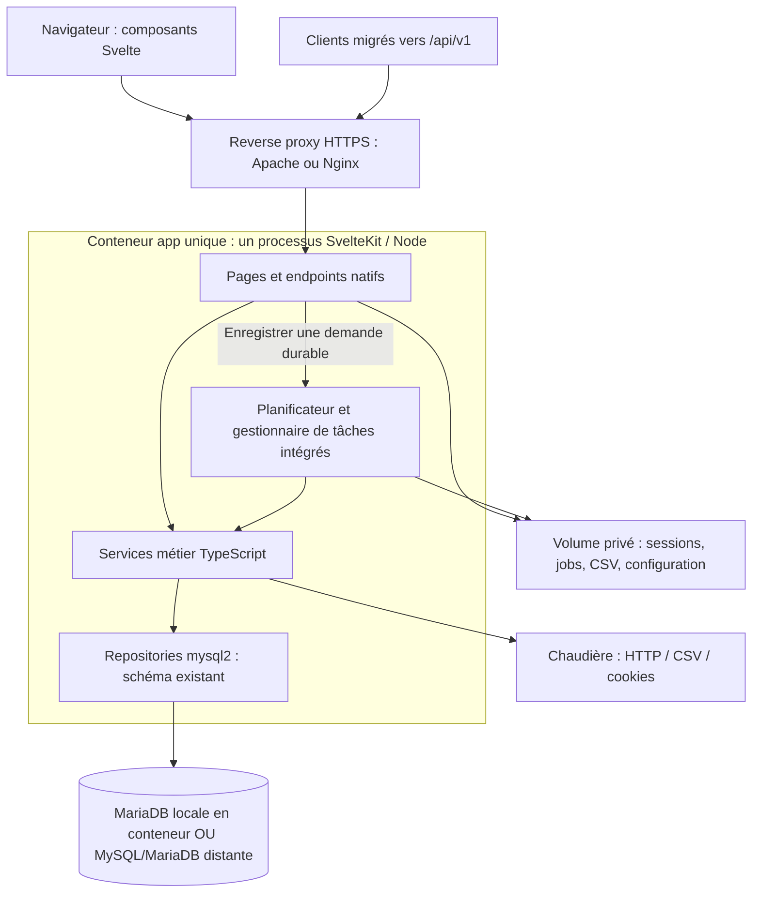

# Architecture applicative cible : Svelte et Node.js

## 1. Décision proposée

Construire un **monolithe modulaire TypeScript avec SvelteKit**, exécuté sur Node.js via `@sveltejs/adapter-node`. Svelte fournit l'interface; SvelteKit porte les pages, les formulaires et les endpoints HTTP; les services métier et accès MySQL restent exclusivement côté serveur.

L'application est **un seul projet SvelteKit, exécuté dans un seul processus Node et un seul conteneur applicatif**, déployé avec Docker Compose. Les collectes, imports et synthèses sont intégrés au serveur, sans worker séparé. Deux modes sont prévus : MariaDB intégrée à la composition ou MySQL/MariaDB distante, sans conteneur de base local. Les API utilisent uniquement le routage natif SvelteKit, sans conserver de chemins PHP.

Ce choix précise la possibilité laissée ouverte dans l'[étude initiale](./analyse-technique-et-faisabilite-node-svelte.md) et couvre l'[inventaire fonctionnel](./inventaire-fonctionnel-actuel.md).

### Invariants

- Conserver **MySQL et la structure des données existantes** : pas de renommage de table/colonne, changement de type, moteur ou index, ni ajout implicite de table de sessions/jobs.
- Lire les bases existantes sans lancer un outil de génération de schéma.
- Préserver les correspondances capteurs/colonnes, unités, coefficients, dates et calculs historiques.
- Préserver les adaptations de matrice nécessaires à F10 : l'ajout d'un capteur peut ajouter une colonne `col_n` selon le mécanisme historique. Cette opération explicite n'autorise pas une refonte du modèle.
- Garder une seule instance du serveur applicatif au départ, sur un seul hôte. Les besoins de réplication ou de haute disponibilité distribuée seraient une autre étude.
- Ne pas reproduire les défauts de sécurité comme conditions de compatibilité.
- Exposer les API par des fichiers `+server.ts` sous `/api/v1`; ne pas reprendre le dispatch `type/action` ni les URLs PHP historiques. Les clients existants devront migrer.
- Déployer un seul service applicatif `app`, incluant le planificateur et l'exécution des tâches; permettre de choisir la base locale ou distante sans reconstruire son image.

Ce document est une **proposition**, pas une implémentation ni un résultat de benchmark. Les dernières versions stables de Svelte et SvelteKit sont exigées à l'initialisation, avec la version stable de TypeScript la plus récente compatible avec le socle et ses outils, en mode strict, et un Node.js LTS supporté. La [matrice de versions](./reorganisation-depot-et-demarrage-sveltekit.md#7-versions-des-bibliothèques-et-compatibilité) retient TypeScript `6.0.3`, plutôt que TypeScript 7 dont le support n'est pas déclaré. Les versions seront verrouillées et validées par le POC. Rien n'est installé par cette étude.

## 2. Vue logique



Les pages, API, services métier et traitements planifiés appartiennent au **même projet SvelteKit et au même processus serveur**. Le planificateur est initialisé une seule fois au démarrage, sans cron sur l'hôte ni second service Node. Le gestionnaire de tâches exécute les demandes persistées indépendamment de la durée des requêtes navigateur. Le navigateur n'accède jamais directement à MySQL ni à la chaudière.

### Pourquoi ce choix

- SvelteKit fournit déjà routage, rendu serveur, gestion des formulaires et endpoints : ajouter Express/Fastify/NestJS immédiatement dupliquerait les responsabilités.
- Une seule origine web simplifie cookies et protection CSRF; pas de CORS permissif par défaut.
- Un découpage en services conserve la possibilité de séparer un backend plus tard, sans imposer aujourd'hui microservices, bus ou Redis.
- Un worker séparé ne serait envisagé que si des mesures démontrent que les traitements dégradent le service HTTP malgré le streaming et le découpage en lots; il ne fait pas partie de cette cible.
- Les bibliothèques liées au DOM et aux graphiques sont chargées côté navigateur uniquement; le SSR ne doit pas interroger la chaudière.

## 3. Découpage des responsabilités

| Module | Responsabilités | Fonctionnalités |
|---|---|---|
| Installation et configuration | Contrôler une base existante, configurer l'installation, verrouiller l'assistant, version applicative | F01, F14, F18 |
| Identité | Connexion, changement de mot de passe, sessions, permissions et clients API | F02, F15 |
| Mesures et rapports | Mesures journalières, indicateurs, agrégats mensuels/saisonniers, annotations | F03, F04, F05 |
| Approvisionnements et entretien | Événements, calcul stock, seuils cendrier | F06, F07 |
| Saisons | Calendrier de chauffe et CRUD des saisons | F08 |
| Graphiques et capteurs | Configuration, ordre, coefficients et matrice CSV | F09, F10 |
| Imports et synthèses | Ingestion CSV, dédoublonnage, calculs, reprise des tâches | F11, F12, F16 |
| Connecteur chaudière | Authentification HTTP, cookie jar, mesures, métadonnées et commandes | F13 |
| Interface et traduction | Navigation, formulaires, messages, langues et accessibilité | F17 et toutes les pages |

### Organisation indicative du futur code

```text
src/
  routes/
    +layout.svelte
    +page.svelte
    historique/
    temps-reel/
    administration/
    imports/
    installation/
    api/
      v1/
        mesures/+server.ts
        saisons/+server.ts
        saisons/[id]/+server.ts
        imports/+server.ts
        jobs/[id]/+server.ts
        chaudiere/
          indicateurs/+server.ts
          commandes/+server.ts
  lib/
    components/
    contracts/
    server/
      config/
      auth/
      services/
      repositories/
      boiler/
      jobs/
        scheduler.ts
        runner.ts
        store.ts
  hooks.server.ts
messages/
tests/
  fixtures/
  unit/
  integration/
  e2e/
Dockerfile
.dockerignore
compose.yaml
compose.db.yaml
.env.remote.example
.env.local.example
```

Cette arborescence est un schéma de destination, pas une liste de fichiers créés. Le code `server` et ses secrets ne doivent jamais être importés par les composants. Les contrats partagés contiennent types et schémas de validation, sans accès DB.

Les modules `jobs` font partie du build serveur SvelteKit, sans exécutable ni build séparé. `scheduler.ts` planifie les collectes, `runner.ts` exécute les tâches et `store.ts` persiste demandes, progression et résultats. Ils appellent les mêmes services que les routes, avec des paramètres explicites plutôt qu'un contexte HTTP `event.locals`. L'initialisation est raccordée au cycle de démarrage serveur décrit en section 8.

## 4. Bibliothèques recommandées

Les liens renvoient à la documentation du projet ou à son dépôt officiel. Ils ont été consultés pour cette étude. « Retenu » signifie recommandé pour la future implémentation, pas installé dans ce dépôt.

### 4.1 Interface et socle full-stack

| Besoin | Paquet / API | Choix et justification |
|---|---|---|
| Composants et réactivité | [`svelte`](https://svelte.dev/docs/svelte/overview) | Retenu. Composants typés, état local et état partagé limité aux besoins réels. Pas de jQuery ni Redux. |
| Pages, formulaires, API et SSR | [`@sveltejs/kit`](https://svelte.dev/docs/kit/introduction) | Retenu. `load` côté serveur pour les lectures initiales; actions de formulaire pour les mutations d'écran; `+server.ts` pour les contrats API et uploads. |
| Serveur de production | [`@sveltejs/adapter-node`](https://svelte.dev/docs/kit/adapter-node) | Retenu. Build produisant un serveur Node autonome, derrière le reverse proxy. |
| Build et typage | [`vite`](https://vite.dev/guide/), [`typescript`](https://www.typescriptlang.org/docs/), [`svelte-check`](https://svelte.dev/docs/cli/sv-check) | Retenus comme outils de développement. TypeScript strict; versions choisies selon la matrice SvelteKit/Node et verrouillées. |
| Modales, menus, onglets et contrôles accessibles | [`bits-ui`](https://bits-ui.com/docs/introduction) | Retenu. Primitives Svelte sans imposer un thème; CSS applicatif simple. Champs date/heure natifs au premier passage, testés sur les navigateurs cibles. |
| Ordre des graphiques et des courbes | [`svelte-dnd-action`](https://github.com/isaacHagoel/svelte-dnd-action) | Retenu pour conserver le glisser-déposer. Ajouter des commandes « monter/descendre » accessibles au clavier; valider la version avec Svelte retenu. |
| Traductions | [`@inlang/paraglide-js`](https://paraglidejs.com/sveltekit) | Retenu. Catalogues FR/EN typés et intégration SSR; langue d'installation issue de la configuration, sans nouvelle table ni ajout automatique de préfixes d'URL. |
| Graphiques | [`highcharts`](https://www.highcharts.com/docs/getting-started/installation), bundle Stock selon les besoins | Choix de parité privilégié : séries, axes multiples, zoom synchronisé et annotations proches de l'existant. **Soumis à validation de licence**; la présence des anciens fichiers ne vaut pas droit d'usage des nouvelles versions. |

Highcharts sera encapsulé dans un composant Svelte qui gère création, mise à jour et destruction, sans imposer de wrapper supplémentaire. Charger le code dans le cycle de vie navigateur. Ne pas activer de service distant d'export : aucune donnée chaudière ne doit être envoyée à un tiers. Si la licence ne convient pas, étudier séparément Apache ECharts et refaire une preuve de parité, plutôt que promettre un remplacement transparent.

Les notifications peuvent être un composant applicatif avec région `aria-live`; aucun paquet de toast n'est nécessaire au départ. Les formulaires utilisent SvelteKit et Zod, sans ajout automatique d'une seconde couche de gestion de formulaires.

### 4.2 Backend Node.js et intégrations

| Besoin | Paquet / API | Choix et contraintes |
|---|---|---|
| Accès MySQL | [`mysql2`](https://sidorares.github.io/node-mysql2/docs), API `mysql2/promise` | Retenu. Pool borné et requêtes préparées pour les valeurs; adapté au schéma existant et aux colonnes dynamiques. Pas d'ORM ni de synchronisation automatique du schéma. |
| Validation des entrées | [`zod`](https://zod.dev/) | Retenu. Validation côté serveur des paramètres, fichiers de configuration, types d'événements et réponses du connecteur chaudière. Validation navigateur utile mais non suffisante. |
| Décimales | [`decimal.js`](https://mikemcl.github.io/decimal.js/) | Retenu lorsque des calculs sortent de MySQL : valeurs `DECIMAL`, coefficients et arrondis contrôlés. Garder les agrégats SQL existants au début plutôt que changer simultanément moteur de calcul et runtime. |
| Dates et fuseaux | [`luxon`](https://github.com/moment/luxon) | Retenu pour dates de chauffe, périodes et changements d'heure. Compléter avec `Intl` pour l'affichage. Ne pas appliquer une « correction UTC » globale aux timestamps historiques. |
| Lecture CSV | [`csv-parse`](https://csv.js.org/parse/) | Retenu en streaming, avec dialecte explicite `;`, gestion des champs vides, en-têtes et erreurs de ligne. Reproduire les cas caractérisés, pas les découpes approximatives. |
| Encodages CSV anciens | [`iconv-lite`](https://github.com/pillarjs/iconv-lite) | Conditionnel aux fixtures : décoder les formats réellement rencontrés. Aucun choix d'encodage silencieux en cas d'ambiguïté. |
| Upload multipart | [`busboy`](https://github.com/mscdex/busboy) | Retenu pour borner les tailles et écrire progressivement sur disque privé. Adapter `Request.body` Web Stream au flux Node; limites cohérentes entre proxy, adapter et parseur. |
| HTTP chaudière | `fetch`, `AbortController` de Node + [`fetch-cookie`](https://github.com/valeriangalliat/fetch-cookie) | Retenus. Cookie jar fourni par `fetch-cookie`/`tough-cookie`, isolé par installation. Pas de cookie de chaudière transmis au navigateur; délais et redirections contrôlés. |
| Liste de fichiers chaudière | [`cheerio`](https://cheerio.js.org/docs/intro/) | Retenu pour analyser le listing HTML sans navigateur. Autoriser uniquement les liens/fichiers issus de l'hôte chaudière configuré. |
| Logs | [`pino`](https://github.com/pinojs/pino) | Retenu. JSON structuré, identifiant de requête/job et masquage des secrets; sortie standard récupérée par le superviseur. |
| Cryptographie | `node:crypto` | Utiliser `randomBytes`, `scrypt` asynchrone, comparaison à temps constant et chiffrement authentifié si stockage de secrets nécessaire. Pas de JWT ni de nouveau framework d'identité requis pour ce déploiement local. |
| Fichiers et verrous métier | `node:fs/promises`, verrous MySQL nommés sur connexion dédiée | Retenus. Stockage privé hors assets publics; les verrous couvrent les mutations HTTP et les tâches intégrées. Un verrou ne remplace pas une transaction MyISAM. |
| Planification intégrée au serveur SvelteKit | [`node-cron`](https://nodecron.com/api-reference) | Retenu dans le processus applicatif. Planifier la collecte avec fuseau explicite et prévention des chevauchements; ne remplace ni le stockage durable des demandes ni les verrous métier. |

Le support réel des versions MySQL/MariaDB déployées doit être testé avec le pilote choisi. L'ancien changelog ne garantit ni la version de production ni ses modes SQL.

### 4.3 Tests et qualité

| Besoin | Paquet | Utilisation |
|---|---|---|
| Tests unitaires et intégration | [`vitest`](https://vitest.dev/guide/) | Calculs, contrats, repositories sur copie MySQL, connecteur et jobs. |
| Parcours navigateur | [`@playwright/test`](https://playwright.dev/docs/intro) | Chromium, Firefox et WebKit; réordonnancement, imports, dates, session et navigation. |
| Analyse statique | [`eslint`](https://eslint.org/), [`eslint-plugin-svelte`](https://github.com/sveltejs/eslint-plugin-svelte), [`typescript-eslint`](https://typescript-eslint.io/) | Règles TypeScript et Svelte cohérentes avec le générateur choisi. |
| Contrôle des types | `svelte-check` et TypeScript | Pages, composants et modules serveur, y compris les tâches intégrées, vérifiés dans la CI. |

Installer les dépendances uniquement lors du POC, avec lockfile et commandes de CI reproductibles. Ne pas copier des exigences de version minimales d'un seul paquet pour définir toute la plateforme.

### 4.4 Versions à utiliser

La [matrice centralisée des versions](./reorganisation-depot-et-demarrage-sveltekit.md#7-versions-des-bibliothèques-et-compatibilité) liste les versions exactes observées du socle, des bibliothèques métier et des outils, ainsi que leurs contraintes. Elle fait référence pour préparer l'initialisation. Au 11 novembre 2026, retenir Svelte `5.57.3`, SvelteKit `3.2.0` et **TypeScript `6.0.3`**, qui satisfait les plages déclarées de Kit, svelte-check et typescript-eslint. TypeScript `7.0.2` n'est pas retenu car ces plages l'excluent. Le conflit identifié est levé par ce choix; la compatibilité complète reste à vérifier par installation, contrôle de types, lint, tests et build.

## 5. Persistance et compatibilité MySQL

| Données conservées | Propriétaire métier cible |
|---|---|
| `oko_user` | Identité et accès chaudière |
| `oko_capteur`, `oko_graphe`, `oko_asso_capteur_graphe` | Capteurs, matrice et graphiques |
| `oko_historique_full` et ses `col_n` | Imports et mesures |
| `oko_resume_day`, `oko_dateref` | Synthèses et rapports |
| `oko_saisons` | Saisons |
| `oko_silo_events` | Stock et entretien |
| `oko_boiler` | Historique des configurations chaudière |

Règles de réalisation :

1. Relever le schéma effectivement présent avant connexion en écriture et le comparer aux attentes; ne pas relancer le [SQL d'installation actuel](../archive/php/install/install.sql) sur une base conservée.
2. Garder les `DECIMAL` sous forme de chaînes dans les repositories; convertir explicitement à la frontière graphique ou calcul. Lire `DATE`/`TIME` sans conversion automatique en objets `Date`.
3. Initialiser chaque connexion du pool avec le fuseau et les modes SQL déterminés par les tests de parité. Ne pas dépendre du fuseau local du processus Node.
4. Les identifiants SQL dynamiques ne sont pas des paramètres `?` : valider `col_n` à partir de la matrice et des colonnes réellement présentes, puis utiliser une construction SQL contrôlée.
5. Préserver la clé `(jour, heure)`, le comportement de réimport et l'arrondi à la minute. Toute correction de mesure existante est une évolution distincte.
6. MyISAM ne permet pas de rendre une séquence atomique par un simple `BEGIN/COMMIT`. Prévalider les données, sérialiser les mutations et contrôler les postconditions. Les interruptions restent à gérer explicitement.
7. Un changement de matrice acquiert le même verrou que les imports. Les ajouts de colonnes restent une opération administrative journalisée, précédée d'une sauvegarde.
8. Les métriques et critères de parité doivent distinguer `null`, zéro, absence de capteur et absence de donnée; ne pas harmoniser arbitrairement ces valeurs.

Source du modèle : [install.sql](../archive/php/install/install.sql), [mise à jour de matrice](../archive/php/_include/administration.class.php#L846).

## 6. Sessions, permissions et secrets sans changer le schéma

### Sessions navigateur

- Cookie opaque, aléatoire, `HttpOnly`, `Secure` sous HTTPS et `SameSite` adapté à l'usage; identifiant renouvelé à la connexion et invalidé à la déconnexion.
- Dépôt de sessions **sur volume privé local**, avec expiration serveur, nettoyage et permissions restrictives; pas de nouvelle table.
- Seul le serveur web lit/écrit ces sessions. Le projet fournit un petit repository de sessions testable, sans implémenter ses propres primitives cryptographiques.
- Le passage depuis PHP force une nouvelle connexion : ne pas tenter de partager les sessions PHP et Node.
- Toute route mutatrice vérifie utilisateur, permission, origine et protection CSRF. Les contrôles natifs de formulaires SvelteKit ne dispensent pas de protéger les endpoints JSON sous `/api/v1`.
- Les protections anti-bruteforce et limites HTTP sont configurées au proxy; les commandes sensibles sont également limitées côté application. Aucune confiance dans un en-tête XHR.

### Comptes existants

Lire les utilisateurs dans la table existante. Deux voies explicites :

- Compatibilité temporaire de vérification des empreintes historiques, puis remplacement par une chaîne versionnée de hash scrypt dans le champ `pass` existant après connexion réussie.
- Réinitialisation contrôlée si la compatibilité n'est pas démontrée, notamment pour le prétraitement d'échappement PHP avant SHA-1.

La taille encodée du nouveau format doit tenir dans le champ existant; ne pas lancer de changement de type pour contourner ce point. L'écriture d'un nouveau hash n'est pas une modification de structure, mais elle rend la reconnexion sous l'ancien PHP incompatible : sauvegarde, point de non-retour et procédure de retour arrière doivent en tenir compte.

### Secrets d'exploitation et clients API

- Secrets DB et clé de chiffrement dans la configuration du service, jamais dans le bundle navigateur ni le dépôt Git.
- Charger une configuration JSON validée pour les paramètres modifiables depuis l'interface; écrire atomiquement sur disque.
- Reprendre les anciens secrets chaudière via une procédure opérateur, sans exécuter du PHP depuis Node. Placer les nouveaux secrets dans un fichier privé chiffré, clé fournie par l'environnement; ne pas remplacer silencieusement les champs Base64 par un format que PHP ne sait pas lire.
- Garder un registre privé de jetons API hachés et permissions, hors tables métier. Compatibilité du jeton historique seulement pendant la transition, avec rotation explicite par client.
- Pour la langue, séparer les libellés Paraglide des correspondances techniques de capteurs : le connecteur ne doit pas déduire une adresse chaudière d'un libellé traduit.
- En SSR, conserver le contexte de langue et d'utilisateur par requête; aucun état global partagé entre visiteurs. Les anciens messages contenant du HTML doivent être convertis en composants ou en contenu explicitement maîtrisé, sans réinjection HTML arbitraire.

## 7. API et flux applicatifs

### Nouvelle interface

- Lectures initiales des pages via les services serveur, sans boucle HTTP interne vers sa propre API.
- Formulaires SvelteKit avec validation Zod; erreurs explicites, sans masquer les échecs par un succès.
- Endpoints versionnés proposés sous `/api/v1` pour mesures, synthèses, stock, événements, saisons, graphiques, matrice, jobs et chaudière.
- Chaque route a un contrat d'entrée/sortie, une permission et un code d'erreur stable. Les commandes chaudière sont toujours authentifiées et séparées des lectures publiques.

### Endpoints natifs SvelteKit

Utiliser le [routage serveur natif SvelteKit](https://svelte.dev/docs/kit/routing) : chaque ressource possède un `+server.ts` avec des handlers typés `GET`, `POST`, `PATCH` ou `DELETE`. Les réponses JSON utilisent les helpers SvelteKit; validation et permissions précèdent l'appel au service métier.

| Endpoint proposé | Méthodes | Usage |
|---|---|---|
| `/api/v1/mesures?jour=YYYY-MM-DD&grapheId=...` | GET | Séries journalières; noms de paramètres unifiés |
| `/api/v1/saisons` et `/api/v1/saisons/[id]` | GET, POST sur collection; GET, PATCH, DELETE sur élément | Consultation et gestion des saisons |
| `/api/v1/imports` | POST | Upload ou demande d'import, réponse `202` avec identifiant de job |
| `/api/v1/jobs/[id]` | GET | Suivi d'un traitement autorisé pour le demandeur |
| `/api/v1/chaudiere/indicateurs?circuit=...` | GET | Lecture temps réel avec circuit explicitement validé |
| `/api/v1/chaudiere/commandes` | POST | Commande explicite et contrôlée, jamais une mutation en GET |

Ces exemples précisent le modèle d'exposition; les autres ressources suivent les mêmes conventions. Les mutations d'écran peuvent utiliser des actions de formulaire dans `+page.server.ts`, avec amélioration progressive via `use:enhance`. Les données initiales utilisent les fonctions `load` de `+page.server.ts`/`+layout.server.ts`. Tous ces points d'entrée délèguent aux mêmes services, sans dupliquer les calculs.

### Migration des intégrations existantes

L'[inventaire](./inventaire-fonctionnel-actuel.md#4-inventaire-des-actions-serveur-actives) reste la référence du comportement historique, pas la définition des nouvelles URLs. Préparer une table de correspondance de chaque action conservée vers sa ressource/méthode native, et documenter les nouveaux paramètres, erreurs et jetons.

**Aucun endpoint nommé `ajax.php` ou `api.php`, ni adaptateur de dispatch `type/action`, ne fait partie de la cible.** La conservation des fonctionnalités n'implique pas la conservation de ces contrats HTTP. Recenser les consommateurs, mettre à jour leurs appels et valider leurs tests avant bascule; un client non migré est un blocage de mise en service, pas une justification pour recréer les routes PHP dans SvelteKit.

Le proxy transmet les nouvelles routes à SvelteKit sans réécriture vers PHP. Une éventuelle installation PHP maintenue pendant la transition reste distincte et ne partage pas les écritures concurrentes avec la cible.

### Temps réel

Garder initialement un polling proche des trois secondes existantes, mais ne lancer le suivant qu'après la fin du précédent. Arrêter à la sortie de page, annuler les requêtes obsolètes et borner les points conservés en mémoire.

Le connecteur sérialise les échanges incompatibles entre eux et limite les appels par chaudière. En cas d'échec d'une écriture, ne pas réessayer aveuglément : signaler un résultat incertain et relire l'état si le protocole le permet. Les bornes/diviseurs doivent être validés serveur; une confirmation utilisateur et une trace de commande sont requises. Le statut « configuration enregistrée » doit être distinct de « modification appliquée et vérifiée ».

WebSockets et SSE ne sont pas nécessaires pour reproduire les fonctions actuelles.

## 8. Imports, jobs et ordonnanceur

### Exécution intégrée et cycle de vie

Le serveur SvelteKit héberge le planificateur et le gestionnaire de tâches dans son propre processus Node. Initialiser ce service une seule fois via le hook serveur `init` de `hooks.server.ts`, avec une version SvelteKit qui le prend en charge. L'initialisation valide la configuration, récupère les états interrompus et démarre la consommation des demandes; elle n'attend pas l'exécution des imports pour rendre le serveur disponible.

**État du portage** : la collecte IP utilise `node-cron` à la minute 02 toutes les deux heures, avec fuseau explicite, et crée aussi une demande au démarrage lorsque `tcRef` et les autres paramètres sont configurés. Les demandes sont stockées dans un répertoire privé et l'import manuel utilise la même file. Les tâches interrompues restent signalées et les journées partiellement traitées sont reprises par une collecte ultérieure. Le mode sans IP n'est pas porté. Les CSV restent actuellement chargés en mémoire avec une limite de 16 Mio : le streaming, la mesure de latence et la validation complète sur une base MyISAM restent nécessaires avant mise en service. Les configurations Docker fournies ne montent pas encore le répertoire de tâches.

Ne pas démarrer de tâches pendant le build ou le prerender (`building` de `$app/env`), ni depuis `load`, un composant, le hook de requête `handle` ou un endpoint. En développement, désactiver la planification réelle par défaut pour éviter les doubles déclenchements liés au rechargement; les tests utilisent une activation explicite et un connecteur simulé. Le POC vérifie l'initialisation unique dans le build `adapter-node` de production.

`node-cron` déclenche l'enregistrement de demandes durables; le gestionnaire intégré les consomme avec une concurrence bornée, initialement une seule tâche d'écriture métier à la fois. Les imports HTTP et les tâches planifiées empruntent cette même file. Les mutations directes incompatibles, notamment de matrice, prennent les mêmes verrous. Aucun simple appel asynchrone lancé puis oublié depuis un endpoint ne tient lieu de gestionnaire de tâches.

### Parcours d'un import

1. L'upload passe par un endpoint streaming; contrôle de la taille, du contenu, de la matrice et du nom avant traitement. Le plafond de départ peut reprendre les 3 000 000 octets indiqués par les scripts actuels, à confirmer sur les fichiers réels; le proxy doit laisser la marge multipart nécessaire.
2. Créer un fichier de travail propre au job, hors répertoire public. Ne plus utiliser un unique fichier d'import partagé.
3. Déposer une demande durable sur volume privé, avec identifiant, type, auteur et état; répondre au navigateur avec l'identifiant du job uniquement après confirmation de sa persistance.
4. Le gestionnaire intégré réclame les demandes de façon exclusive, prévalide et exécute les imports/synthèses en réutilisant les services, sans maintenir la requête HTTP ouverte.
5. Un journal de job et son résultat persistent par écriture atomique. Après redémarrage, un job marqué en cours passe en récupération/échec explicite avant toute reprise.
6. Un verrou nommé MySQL sur une connexion dédiée empêche les imports/matrices concurrents entre tâches et mutations HTTP. La perte de cette connexion doit arrêter le traitement; ne pas remettre la connexion verrouillée dans le pool.
7. La reprise s'appuie sur le dédoublonnage historique et des vérifications de lignes/jours; ne pas promettre un « exactement une fois » avec MyISAM.

### Réactivité, reprise et arrêt

La fréquence et le fuseau de collecte sont validés au démarrage; aucune fréquence n'est inventée par la migration. Au redémarrage, le gestionnaire examine les jobs interrompus et les jours à rattraper; l'ordonnanceur en mémoire n'est pas une garantie de rattrapage. Préserver une progression consultable via l'API et distinguer attente, exécution, récupération, succès et échec. Toute erreur est persistée et journalisée, sans promesse de reprise automatique d'une commande chaudière incertaine.

Les traitements partagent la boucle événementielle avec HTTP : `async` ne rend pas un calcul synchrone non bloquant. Lire les CSV en streaming, travailler en lots bornés, rendre régulièrement la main à la boucle événementielle et limiter la pression sur le pool MySQL. Éviter les accès disque synchrones et les calculs longs sans interruption. Mesurer la latence des pages/API pendant un import représentatif; le monolithe n'est accepté que si les seuils fixés sont respectés.

Prévoir un arrêt gracieux sur `SIGTERM` et `SIGINT`, coordonné avec celui d'`adapter-node` : arrêter la planification et la prise de nouvelles tâches, laisser finir ou interrompre proprement le lot courant dans un délai borné, persister l'état puis fermer les ressources. Aligner le délai d'arrêt Docker avec celui du serveur; tester également un arrêt forcé, qui doit conduire à un état récupérable et non à un faux succès.

Le volume privé stocke sessions, demandes, résultats et fichiers temporaires; sa sauvegarde, rétention, espace disponible et permissions font partie du déploiement. Ce choix convient au mono-hôte; si plusieurs hôtes deviennent requis, remplacer ce mécanisme par une infrastructure partagée via une décision distincte.

**Coexistence PHP/Node** : les verrous Node n'arrêtent pas le vieux cron PHP. Désactiver opérationnellement l'ancien écrivain avant activation de son remplacement.

## 9. Conteneurs, Docker Compose et exploitation

### 9.1 Image applicative et services

Prévoir un `Dockerfile` multi-stage : installation reproductible avec lockfile, build SvelteKit unique incluant les modules de tâches serveur, puis image d'exécution Node LTS allégée avec les seules dépendances nécessaires. Ne pas embarquer de serveur PHP, de secrets, de sauvegardes ni de CSV de production; les exclure aussi du contexte via `.dockerignore`.

| Service Compose | Image / commande prévues | Réseau et persistance |
|---|---|---|
| `app` | Image applicative; `node build` pour le serveur `adapter-node`, avec planificateur et gestionnaire de tâches intégrés | Une seule instance, port HTTP interne exposé au proxy. Volume privé pour sessions, configuration, demandes/résultats de jobs et CSV |
| `db` — mode local uniquement | Image officielle MariaDB, version compatible testée et épinglée | Volume dédié `/var/lib/mysql`; port 3306 accessible sur le réseau Compose, non publié sur l'hôte par défaut |

MariaDB est la proposition pour le service local; une base distante peut être MySQL ou MariaDB après validation de compatibilité. Remplacer l'image MariaDB par MySQL exige une configuration d'initialisation adaptée et un import logique contrôlé : les volumes de données ne sont pas interchangeables entre ces moteurs.

Exécuter les processus applicatifs sans root avec UID/GID cohérents sur les volumes, politique de redémarrage, contrôles de santé et délais d'arrêt définis. Le système de fichiers de l'image est en lecture seule lorsque possible; seuls les volumes privés et répertoires temporaires désignés sont inscriptibles. Un conteneur de base exige les droits propres à son image officielle.

### 9.2 Deux compositions explicites

Le futur livrable comprendra :

- `compose.yaml` : **un seul service applicatif `app`, sans service de base** et sans dépendance à un service `db`. Utilisable tel quel avec une base distante; aucun service worker.
- `compose.db.yaml` : complément **explicitement sélectionné** qui ajoute MariaDB, son healthcheck et son volume. Le modèle local configure `DB_ADRESSE=db:3306` et le complément ajoute uniquement dans ce mode la dépendance à `db` avec condition `service_healthy`.
- `.env.remote.example` et `.env.local.example` : modèles non secrets documentant les variables requises. Les vraies configurations et fichiers secrets restent hors Git.
- `Dockerfile` et `.dockerignore` : image du serveur SvelteKit unique, incluant ses tâches intégrées.

Utiliser la [fusion native de fichiers Docker Compose](https://docs.docker.com/compose/how-tos/multiple-compose-files/merge/). Ne pas nommer le complément `compose.override.yaml`, afin qu'une base locale ne soit pas démarrée implicitement en mode distant. Ne pas déclarer un `depends_on: db` dans le socle, même derrière un profil : la base doit pouvoir être totalement absente de la composition.

Commandes de déploiement **prévues après création des fichiers et préparation des configurations/secrets**, non exécutables dans le dépôt actuel :

```sh
# MySQL/MariaDB distante : aucun service db local
docker compose --env-file .env.remote -f compose.yaml up -d

# MariaDB locale : ajout explicite du service db
docker compose --env-file .env.local -f compose.yaml -f compose.db.yaml up -d
```

Le mode distant ne doit créer ni conteneur ni volume de base. La même image applicative sert aux deux modes. Les variables du fichier d'environnement Compose doivent être explicitement transmises aux services qui en ont besoin; `--env-file` ne les injecte pas automatiquement toutes dans le processus Node.

### 9.3 Connexion à la base locale ou distante

| Paramètre cible | Mode local | Mode distant |
|---|---|---|
| `DB_ADRESSE` | Nom DNS Compose `db:3306` | Nom DNS ou adresse du serveur distant et port facultatif; jamais `localhost` pour désigner l'hôte depuis le conteneur |
| `DB_NAME`, `DB_USER` | Base et compte applicatif provisionnés | Base et compte applicatif existants ou provisionnés par l'opérateur |
| `DB_PASSWORD` ou `DB_PASSWORD_FILE` | Secret applicatif monté en lecture seule dans `app` | Mot de passe dans l'environnement ou secret monté en lecture seule dans `app` |
| `DB_TLS_MODE`, `DB_TLS_CA_FILE` | TLS selon les exigences du réseau local | TLS vérifié par défaut; autorité et nom serveur validés |

L'application lit explicitement `DB_PASSWORD_FILE`; cette convention n'est pas une fonction automatique de `mysql2`. Pour l'image MariaDB, utiliser ses propres variables d'initialisation et conventions `_FILE` documentées, sans transmettre le mot de passe root aux conteneurs applicatifs.

Le démarrage échoue explicitement si la configuration requise est absente; aucun repli silencieux vers `db`, une base vide ou un autre moteur. Prévoir délai de connexion, pool applicatif partagé borné et reconnexions contrôlées : le budget de connexions couvre requêtes HTTP, tâches et connexions dédiées aux verrous, sans laisser les imports monopoliser les accès. Une base distante indisponible ne doit jamais provoquer la création d'une base locale de secours.

Pour une base distante, valider sortie réseau depuis les conteneurs, DNS, règles pare-feu, autorisations du compte et certificats. Ne pas désactiver la validation TLS pour contourner un échec; toute exception de transport sur réseau explicitement isolé nécessite une configuration opérateur documentée. Ne pas imposer `network_mode: host` : un réseau bridge avec les sorties autorisées doit permettre d'atteindre la chaudière et la base.

Le compte courant reçoit les droits métier nécessaires, pas un accès root. Les opérations de création de schéma/colonnes utilisent une procédure administrative explicitement autorisée. En mode distant, aucune création de base ni modification de structure au démarrage.

### 9.4 Initialisation et persistance

- **Base locale neuve** : provisionner le moteur et le compte, puis lancer une commande d'initialisation séparée, refusant les tables existantes. Ne pas monter le SQL destructif historique en script automatique d'initialisation de l'image DB.
- **Reprise des données existantes en local** : sauvegarde logique, import/restauration vers le service choisi, contrôles de structure et de résultats avant bascule. Conserver les moteurs/types/colonnes et vérifier leur support par la version choisie.
- **Base distante existante** : diagnostic et raccordement, sans copier les données par défaut et sans initialisation automatique.
- Le volume DB local, les configurations et le stockage des jobs sont persistants indépendamment du cycle de vie des conteneurs. Sauvegarder la base via une procédure cohérente avec MyISAM; un volume Docker seul n'est pas une sauvegarde.
- Les fichiers de demandes/résultats, CSV, sessions et secrets sont hors répertoires servis publiquement; limiter les montages par service au strict nécessaire.
- Le mode distant déplace la responsabilité de sauvegarde/restauration DB vers l'exploitant du serveur; les volumes applicatifs restent à sauvegarder.

### 9.5 Livraison, réseau et surveillance

- Reprise d'une base : diagnostic en lecture, sauvegarde vérifiée puis raccordement, sans aucun `DROP TABLE`.
- Installation neuve : commande opérateur d'initialisation explicitement séparée, refusant une base déjà peuplée; assistant web limité au paramétrage et verrouillé après activation.
- Un seul conteneur applicatif SvelteKit, avec planification et tâches intégrées; arrêt et redémarrage gérés par Docker Compose. Ne pas multiplier les réplicas ni employer un mode cluster Node. Lors d'une mise à jour, arrêter l'ancienne instance avant d'activer la nouvelle pour éviter deux ordonnanceurs; une courte interruption est acceptée dans cette cible.
- Reverse proxy HTTPS, origine et en-têtes de confiance configurés pour `adapter-node`; plafonds d'upload, timeouts et accès privés explicites.
- Contrôles de santé séparant vitalité du processus et disponibilité MySQL. Une chaudière hors ligne est un état métier dégradé, pas nécessairement une raison de redémarrer tout le serveur.
- Logs JSON sur stdout/stderr, durées et résultats des jobs, rotation/rétention Docker configurées par l'exploitation.
- Déploiement d'artefacts reproductibles et versionnés; remplacement de l'auto-écrasement de fichiers exécuté par le serveur web.
- Les statistiques envoyées à l'ancien serveur ne sont **pas reconduites automatiquement**. Conserver l'information de version locale; une vérification distante/une télémétrie nécessite une décision explicite et ne transmet jamais les secrets.
- Docker et Compose sont requis pour la livraison cible. Kubernetes et Redis ne sont pas requis. Le proxy HTTPS peut être existant sur l'hôte ou déployé séparément; sa topologie doit être documentée.

## 10. Couverture de l'existant et changements intentionnels

| Référence inventaire | Destination cible / décision |
|---|---|
| F01 | Assistant verrouillé et commande d'initialisation neuve séparée; jamais une réinstallation destructive sur base existante |
| F02 | Identité serveur, sessions locales privées et connexion renouvelée à la bascule |
| F03 | Page Svelte journalière, service mesures, graphiques synchronisés et annotations |
| F04 | Page d'historique, agrégats SQL caractérisés et jours sans données conservés |
| F05 | Page saison, graphiques et tableau, mêmes règles de périodes/arrondis avant toute évolution |
| F06 | Service stock/cendrier, mêmes événements de référence et seuils explicitement testés |
| F07 | Écrans événements et repository conservant les types `PELLET/BAG/MAINT/SWEEP/ASHES` |
| F08 | Écrans saisons et calcul de dates testé sur années bissextiles |
| F09 | Configuration Svelte, DnD et boutons clavier; positions/coefficients conservés |
| F10 | Service matrice, prévisualisation et adaptation contrôlée des colonnes; suppression destructive réservée et confirmée |
| F11 | Endpoints d'upload, connecteur HTTP et jobs d'import avec fichiers isolés |
| F12 | Services de synthèse et jobs pour une journée ou une période |
| F13 | Connecteur isolé, page temps réel, configurations datées et commandes distinctes de la sauvegarde |
| F14 | Configuration JSON validée et écriture atomique, secrets séparés |
| F15 | Endpoints natifs SvelteKit sous `/api/v1`, contrats documentés et clients historiques migrés; aucune route PHP |
| F16 | Ordonnanceur `node-cron` et gestionnaire de tâches intégrés au serveur SvelteKit, collecte/synthèses et un seul écrivain |
| F17 | Paraglide FR/EN, composants accessibles, notifications et gestion de chargement |
| F18 | Version locale et déploiement contrôlé; auto-update et statistiques historiques non reconduits à l'identique |

Le FTP dormant, la prévision d'épuisement de stock et les exports non raccordés ne deviennent pas des exigences de la cible. Ils restent hors périmètre sans demande explicite.

## 11. Preuve de faisabilité avant de construire toute la cible

| POC / validation | Critère d'acceptation |
|---|---|
| Lecture DB et séries journalières | Même nombre/ordre de points et mêmes valeurs, unités et annotations sur un jeu de référence; aucune écriture de schéma |
| Import d'un CSV et réimport | Mêmes correspondances et nombres de lignes; réimport sans doublon; erreur de fichier explicite; reprise testée |
| Calculs journaliers et saisonniers | Égalité des résultats au niveau de précision stocké; cas zéro/null/ECS absent, changement d'heure et année bissextile couverts |
| Graphique Svelte | Zoom partagé, changement de jour, séries dynamiques et destruction propre; licence et absence d'appel d'export externe vérifiées |
| Session et permissions | Mutations refusées sans authentification/CSRF appropriés; rotation et expiration testées; aucun secret dans le bundle |
| Jobs intégrés | Redémarrage en cours de tâche, concurrence planification/import et erreur DB n'aboutissent pas à un faux succès; progression persistée et un seul écrivain confirmé |
| Cycle de vie du serveur | Une seule initialisation du planificateur en production; aucune collecte pendant build/prerender; arrêt gracieux et récupération après arrêt forcé testés |
| Réactivité pendant les traitements | Latence pages/API et occupation du pool mesurées pendant import/synthèse représentatifs; seuils d'acceptation respectés sans processus séparé |
| Chaudière | Lecture/reconnexion sur simulateur puis appareil de test; commandes manuelles encadrées, jamais pendant une comparaison en lecture seule |
| Clients API | Chaque fonctionnalité conservée a un endpoint natif testé et un client migré; aucune dépendance restante aux URLs PHP ou au dispatch `type/action` |
| Compose avec base locale | Validation de la composition fusionnée, seuls services applicatif `app` et base `db`, sans worker; healthcheck DB, import/restauration et persistance après recréation testés, sans port DB publié |
| Compose avec base distante | Validation du socle avec seulement `app`, sans worker ni service/volume DB et sans dépendance `db`; connexion MySQL/MariaDB distante, TLS, panne réseau et redémarrage testés avec la même image |
| Retour arrière | Restauration DB/volume démontrée; prise en compte des hashes et secrets devenus incompatibles avec PHP |

Les seuils de latence, RAM et volume seront établis à partir de mesures de l'installation, puis figés avant acceptation. Il serait trompeur de garantir des gains de performance sans ces mesures.

## 12. Conclusion

La cible recommandée est **un seul projet SvelteKit + Node.js + TypeScript + mysql2**, livré dans un seul conteneur applicatif via Docker Compose. Pages, API natives `+server.ts`, métier, planificateur et traitements asynchrones partagent le même processus serveur, sans worker séparé. MySQL/MariaDB peut être locale à la composition ou distante, sans changement du schéma métier. La cible ne conserve ni URLs PHP ni routeur `type/action`.

Le choix de bibliothèques est suffisamment précis pour réaliser un POC; il ne dispense pas de vérifier les versions, licences, contrats historiques et environnements de déploiement avant de démarrer la réécriture complète.
